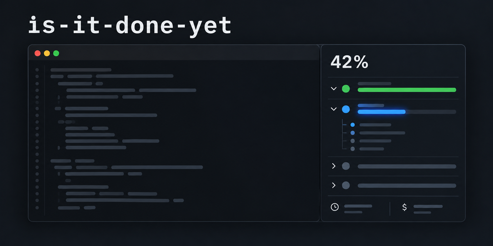
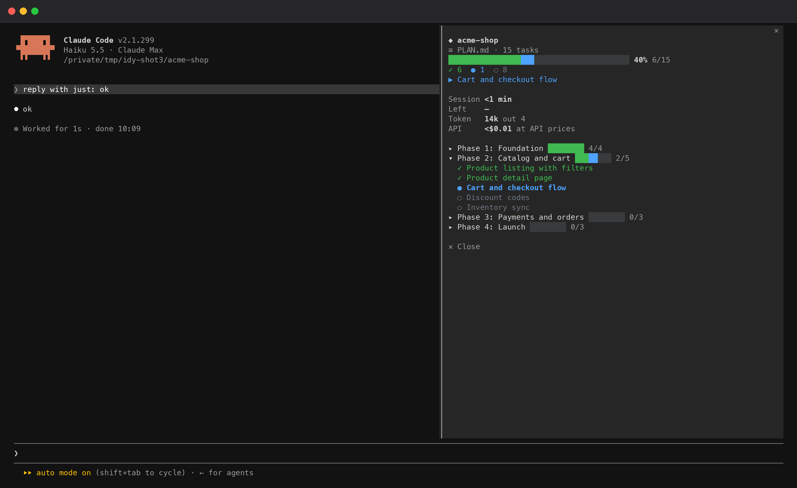
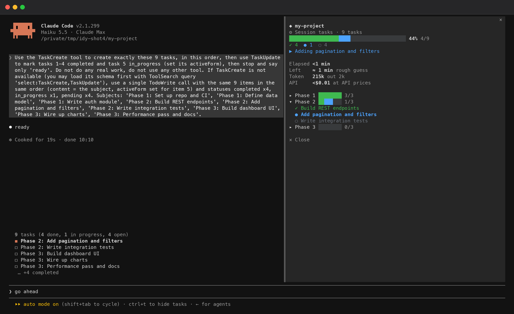

<p align="center">
  
</p>

# is-it-done-yet

**A progress pane for Claude Code.** When an agent works through a big, multi-phase plan, you usually can't tell where it is: how much is done, what is left, how long it has been going, what it has cost. This mod docks a pane beside the terminal that answers those questions at a glance.

**It works on a project that is already underway.** Open Claude Code in a folder that has a plan (`PLAN.md`, `ROADMAP.md`, `TODO.md`, a superpowers or GSD plan) and the pane opens beside the terminal showing where the project stands right now. No setup, no re-planning, no asking the agent to rewrite its task list.

It is a Claude Code **mod** (a plugin that draws and reacts inside the CLI itself). Requires Claude Code 2.1.287 or later.

<p align="center">
  
</p>

## What you see

| In the pane | What it means |
|---|---|
| **Goal** and a **percent bar** | The overall run: `████████░░░░░░  40%  6/15`. |
| 🟩 green / 🟦 blue / ⬜ grey | Done / in progress / not started. Counts for each sit under the bar. |
| `▶ Cart and checkout flow` | The task being worked on right now, or `→ Next: …` when nothing is marked in progress. |
| **Phases** | One accordion section per phase, each with its own bar. Press a header to open or close it. The section with active work opens by itself. |
| **Session / Elapsed** | Time since this session started (plan view), or since the first task was created (task-list view). |
| **Left** | A rough ETA from what *this session* got done: elapsed ÷ tasks finished since you started × tasks left. Hidden until something has been finished in this session. |
| **Token** | Total tokens used this session (input, output and cache), with the output share beside it. |
| **API** | What the session would cost at API prices, the same figure `/cost` totals. Handy when you run on a subscription. |

The labels are plain strings in `is-it-done-yet/hooks/view.tsx` if you want to change them.

## Install

```sh
claude plugin marketplace add gclbck-crealore/is-it-done-yet-mod
claude plugin install is-it-done-yet@is-it-done-yet-mod
```

Or from inside a session, in one step:

```
/plugin install is-it-done-yet --marketplace gclbck-crealore/is-it-done-yet-mod
```

Then run `/reload-plugins` in an open session, or start a new one. (The installer may say one option is "not yet set": that is `autoOpen`, which defaults to on, so you can ignore it.)

To try it for a single session without installing, clone the repo and run:

```sh
claude --plugin-dir ./is-it-done-yet
```

## Use it

Go to your project and start Claude Code. If the folder has a plan file, the pane opens by itself (on a terminal at least 144 columns wide; otherwise type `/progress`). That's it.

| Command | Does |
|---|---|
| `/progress` | Open the pane, or close it if it is open. Also re-reads the plan file. |
| `/progress plan <file>` | Follow one specific plan file (inside the project) instead of auto-detecting, and open the pane. `/progress plan auto` goes back to auto-detect. |
| `/progress goal <text>` | Set the title shown at the top (default: the folder name). |
| `/progress reset` | Clear this session's task list and restart its clock. |
| `/progress open` / `/progress close` | The same as the toggle, explicitly. |

The pane opens by itself when a plan file is found at startup, and the first time the agent creates a task, if the terminal is wide enough (144 columns, or 110 once you have opened it yourself). `/progress` works at any width and re-reads the plan. Turn the automatic open off with the `autoOpen` option in `/plugin`.

### Where the progress comes from

The mod looks at two places and shows the first one it finds a list in. If both have one, a **⇄ button** at the top of the pane flips between them.

**1. The project's plan file.** On startup (and on every `/progress`) it looks in the project folder for, newest file wins:

`PLAN.md` · `TODO.md` · `TASKS.md` · `ROADMAP.md` · `PROGRESS.md` · `docs/PLAN.md` · `docs/ROADMAP.md` · `docs/TODO.md` · `.planning/ROADMAP.md` · `.claude/PLAN.md` · and the newest file in `docs/superpowers/plans/`, `docs/plans/`, `plans/` or `.claude/plans/`.

It understands:

````markdown
## Phase 1: Setup            <- a heading becomes a phase
- [x] Init repo              <- done
- [~] Auth module            <- in progress  ([/] works too)
- [ ] Docs                   <- not started
- [-] Dropped idea           <- cancelled: left out of the count
````

````markdown
- [x] **Phase 1: Foundation**   <- a checkbox with checkboxes under it is a phase (GSD / roadmap style)
  - [x] 01-01 Scaffold
  - [~] 01-02 Schema
````

````markdown
| Phase | Status          |   <- or a status table, when the file has no checkboxes
|-------|-----------------|
| Setup | ✅ Done          |
| API   | 🔄 In progress   |
| UI    | ⬜ Todo          |
````

When the agent ticks a box in the file, the pane picks it up after the next turn (and every 30 seconds while it is open). A file counts as a plan when it has at least two items; use `/progress plan <file>` for anything else.

**2. The session's task list.** The agent's own task tools (`TaskCreate`, `TaskUpdate`, `TodoWrite`) are watched live. If the mod is loaded in the middle of a session or you `/resume` one, it replays the task calls found in the transcript, so the list is not empty. Phases come from a title prefix: `Phase 2: …`, `Faz 2 - …`, `[Stage 3] …`, `P2: …`, or a `phase` key in the task's `metadata`.

<p align="center">
  
</p>

## How it works

```
 project plan file (PLAN.md, ROADMAP.md, ...)          agent calls TaskCreate / TaskUpdate / TodoWrite
        │  read at startup, re-read when it changes            │  a tool.call hook sees each call and its result
        ▼                                                      ▼
 plan tasks ─────────────────────────┐        session task list (also replayed from the transcript)
                                     ▼
                              the pane  ◄── each turn: tokens added, session cost read
                       (state changes redraw it; a 30 s timer refreshes time and ETA while it is open)
```

- **Percent** counts finished tasks only. A task in progress counts as zero until it is done.
- **ETA** is crude on purpose, and counts only what *this session* finished: a plan that was 80% done before you sat down does not make the pace look fast. If your tasks vary a lot in size it will be off.
- **Tokens and cost** are session totals, subagents included, and are not reset by `/progress reset`.
- **After `/clear`** the session list starts empty (it is a new session) but the project plan is read again straight away. After `/resume` the saved list comes back.

## Privacy and reach

Reach **L1, reads**. The mod reads: plan files inside the project folder (regular files up to 512 KB, never through a link that leaves the folder), the task calls found in the session transcript, the task tools' calls and results, each turn's token counts, the session's running cost, and the session id and folder name. It adds **nothing to the model's context** (zero tokens per turn), writes no files, runs no processes, reads no environment variables, and makes **no network calls**. It keeps the session's task list and totals under one key per session in the plugin's own store, plus the file you pinned with `/progress plan`. The full footprint and a five-line threat model are in [is-it-done-yet/README.md](is-it-done-yet/README.md).

## Limitations

- It draws in the terminal and the Desktop app's Code tab. In `claude -p`, the SDK, the VS Code chat panel and cloud sessions there is nothing to draw.
- Plan files are read as markdown checklists and status tables. A plan written as plain prose or numbered steps with no checkboxes can't be tracked; use the task list, or add checkboxes.
- A plan with more than 400 items is cut at 400.
- Tasks replayed from the transcript carry no timestamps, so their timings are unknown.
- Elapsed time is wall-clock, so time you spend away counts.
- The restore-after-`/resume` hook does not run where an organisation manages Claude Code settings.

## Development

```sh
claude plugin validate --strict ./is-it-done-yet
claude plugin test ./is-it-done-yet
```

The code is a few small files in `is-it-done-yet/hooks/`: `model.ts` (tasks, phases, stats, formatting), `plan.ts` (markdown plan parser and transcript replay), `view.tsx` (the pane's layout) and `register.ts` (the hooks). Design decisions and the assumptions that haven't been checked live in [is-it-done-yet/DECISIONS.md](is-it-done-yet/DECISIONS.md).

## Uninstall

```sh
claude plugin uninstall is-it-done-yet@is-it-done-yet-mod
```

or disable it in `/plugin`. It leaves one small store key per session and one per pinned project, which expire on their own.

## License

[MIT](LICENSE) © 2026 Crealore
